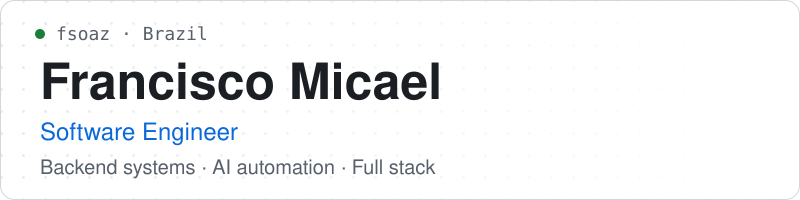
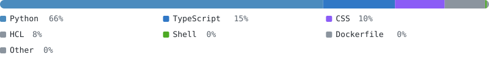

<picture>
  <source media="(prefers-color-scheme: dark)" srcset="assets/banner-dark.svg">
  
</picture>

I'm Francisco, a software engineer in Brazil working on backend systems, AI automation, and full-stack applications. I build with maintainability in mind, using tests, CI, and documentation to make projects easier to run and extend.

Open to full-time roles, internships, and freelance work in backend systems, AI products, and automation.

**[Portfolio](https://fsoaz.github.io/home/)** · **[Contact](https://fsoaz.github.io/home/#contact)**

## Featured projects

### Financial Market Dashboard

A Streamlit app for exploring stocks, indexes, and cryptocurrencies. A separate data pipeline fetches prices from yfinance and CoinGecko, calculates returns, volatility, and drawdown, and saves CSVs for interactive Plotly charts and asset comparisons.

`Python` `Streamlit` `Plotly` `Docker`

[Source](https://github.com/fsoaz/financial-market-dashboard) · [Architecture](https://github.com/fsoaz/financial-market-dashboard/blob/main/docs/explanation/architecture.md)

### Portfolio

A static Next.js site with a custom WebGL black hole renderer and English/Portuguese content. Adaptive rendering quality, keyboard navigation, and fallbacks for reduced motion and unsupported WebGL keep the experience usable across devices.

`TypeScript` `Next.js` `WebGL` `GLSL`

[Source](https://github.com/fsoaz/home) · [Live site](https://fsoaz.github.io/home/)

## Stack

| Area | Tools |
|---|---|
| **Backend** | Python · FastAPI · PostgreSQL · SQLAlchemy |
| **Frontend** | TypeScript · Next.js |
| **AI / Data** | LLM agents · RAG · Evaluations · Streamlit |
| **Mobile** | Kotlin · Android · Room |
| **Delivery** | Docker · GitHub Actions · pytest |

## Language mix

Share of code by bytes across my public, non-fork, non-archived repositories. Updated daily.

<picture>
  <source media="(prefers-color-scheme: dark)" srcset="assets/languages-dark.svg">
  
</picture>

## Recent repository activity

Latest pushes to my public projects. Dates are in UTC and reflect repository updates, including documentation and maintenance.

<!-- RECENT_ACTIVITY:START -->
<<<<<<< HEAD
- **[financial-market-dashboard](https://github.com/fsoaz/financial-market-dashboard)** `Python` · _today_
- **[home](https://github.com/fsoaz/home)** `TypeScript` · _22d ago_
=======
- **[financial-market-dashboard](https://github.com/fsoaz/financial-market-dashboard)** `Python` · _2026-10-11_
- **[home](https://github.com/fsoaz/home)** `TypeScript` · _2026-09-18_
>>>>>>> c1d7cc8 (docs: update README and SVG banners for clarity and consistency)
<!-- RECENT_ACTIVITY:END -->

---

Language charts and activity are updated daily from the public GitHub API. <a href=".github/workflows/update-stats.yml">Workflow</a> · <a href="scripts/generate_stats.py">Generator</a>
