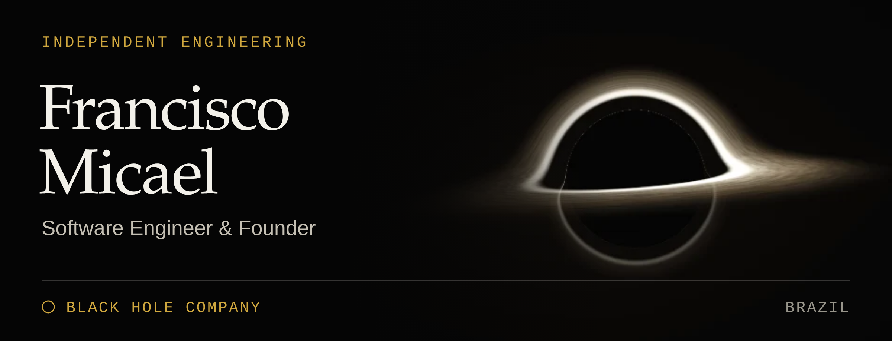

I'm **Francisco Micael**, a software engineer in Brazil and founder of [Black Hole Company](https://blackholeco.com.br/en-US). I build backend systems, AI workflows, and web applications that help businesses connect their tools and reduce manual work.

My focus is practical, maintainable software: understand the problem, build what fits, and make it straightforward to run and extend.

**[Discuss a project ↗](https://blackholeco.com.br/en-US#contact)** &nbsp; · &nbsp; [Personal portfolio](https://fsoaz.github.io/home/)

---

## How I can help

- **Backend & integrations** — APIs, data models, and connections between the systems your business relies on.
- **Automation & AI** — Workflows that reduce repetitive tasks and make information easier to find and use.
- **Web applications** — Internal tools and full-stack applications built around the way your business works.

## Current stack

| Area | Technologies & practices |
| :--- | :--- |
| **Backend** | Python · FastAPI · PostgreSQL · SQLAlchemy |
| **Frontend** | TypeScript · Next.js |
| **AI / Data** | LLM agents · RAG · Evaluations · Streamlit |
| **Mobile** | Kotlin · Android · Room |
| **Delivery** | Docker · GitHub Actions · pytest |

## How I work

I start with the business context and choose the tools to fit. Tests, continuous integration, and clear documentation help keep the result reliable and maintainable through delivery and handover.

---

### Have a process or system that needs to work better?

Tell me what you use today, where the friction is, and what you want to change.

**[Let's discuss it at Black Hole Company ↗](https://blackholeco.com.br/en-US#contact)**
